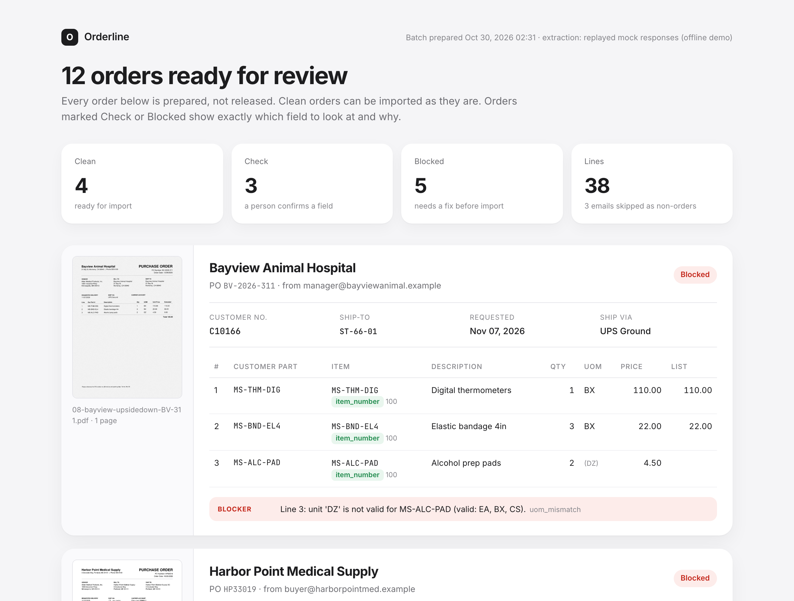
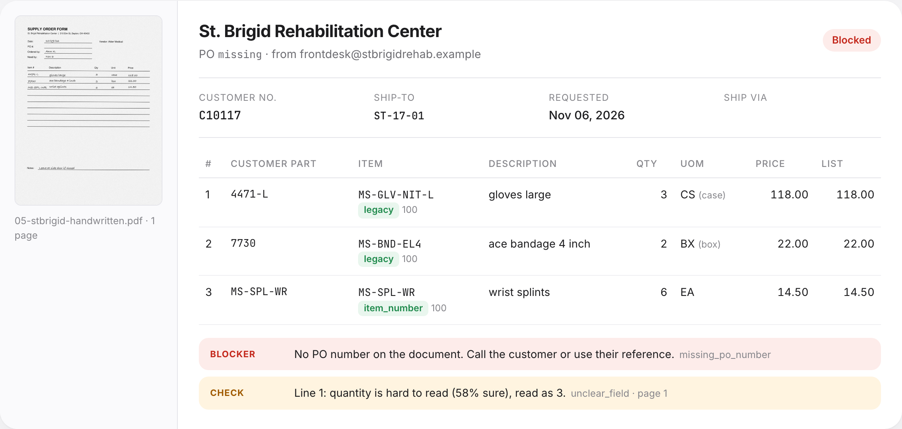
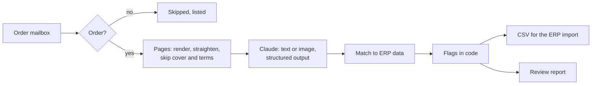

# Orderline

**Purchase orders arrive by email as PDFs, faxes and handwritten forms. Orderline reads them with Claude, matches them to your ERP data and writes import-ready CSVs, with every field it is unsure about flagged for a person.**

[](https://github.com/R3LJA/orderline/actions/workflows/ci.yml)




Order desks still key purchase orders by hand: every customer sends a different layout, half of them are scans, and some are faxed sideways. Orderline watches the order mailbox, reads each PO without per-customer templates, checks every line against your customers, ship-to addresses, item cross-references, units and price lists, and writes one CSV per order where your existing ERP import picks it up.

It prepares orders. It never releases one.

- **No templates.** A customer it has never seen, in a layout it has never seen, works on day one. The model reads; code decides.
- **Hard documents handled.** Faxes, rotated and upside-down scans, multi-page POs with a cover sheet and terms, handwriting.
- **Every doubt is specific.** Not "low confidence", but "Line 2: PO says 12.00 per BX, price list says 12.50" or "No PO number on the document".
- **Deterministic checks.** Prices, units, items, ship-tos and duplicates are checked in code against ERP data, so the same order always gets the same flags.
- **Yours to own.** Runs in your Azure tenant on a timer, reads Microsoft 365 through Graph, uses Claude on Microsoft Foundry or the Claude API. No SaaS, no per-order fees, MIT licensed.

## What happens to one order

A fax from Mesa Orthopedic Partners arrives in `orders@`:

1. **Email.** It has a PDF and says "PO", so it is treated as an order. An invoice, a quote request and a newsletter in the same inbox are skipped and listed.
2. **Pages.** The PDF has no text layer (it is a fax), so the page is rendered as an image. Its orientation is checked; it is upright.
3. **Extraction.** Claude returns the PO number, customer, addresses, carrier account and three lines, each field with its page and a confidence. The price on line 2 is smudged: 62% sure.
4. **Matching.** `MOP-SPL-01` and `MOP-FD-44` resolve through Mesa's cross-references to `MS-SPL-WR` and `MS-DRS-FOAM`; `CS` is a valid unit for gloves; contract prices match.
5. **Flags.** One **check**: "Line 2: unit price is hard to read (62% sure), read as 34.2." Nothing blocks.
6. **Output.** `C10132_MOP-1187_<key>.csv` in the import folder with `REVIEW_STATUS=check` on every row, a JSON sidecar with the evidence, and a card in the review report.



## Hard cases

| Document | What Orderline does |
|---|---|
| Fax with a cover sheet and a terms page | Recognizes both from their text, sends only the order pages, still reads all lines across pages 2 and 3 |
| Scan fed in sideways | Detects that text lines run vertically and turns the page 90 degrees before the model sees it |
| Scan upside down | Detects it from the balance of ascenders and descenders, turns it 180 degrees |
| Handwritten form, no PO number | Reads it as an image, raises a **blocker** for the missing PO number and a **check** for any digit it is unsure about |
| Distributor using legacy part numbers | Resolves `4471-M` through the legacy cross-reference to the current item |
| A part number nobody has seen | **Blocker** with the closest item by description, so the rep can fix it in seconds |
| Unit the item isn't sold in (`DZ` of prep pads) | **Blocker** listing the valid units |
| Price differs from the contract | **Check** with both prices |
| Same PO sent twice | **Blocker** on the second copy, pointing to the first |
| New customer not in the ERP | **Blocker**, the order is still prepared so nothing is lost |

## Architecture



More in [docs/architecture.md](docs/architecture.md).

## Quickstart

```bash
git clone https://github.com/R3LJA/orderline && cd orderline
make install
make demo        # then open out/erp-import/review.html
```

The demo runs offline on the sample inbox (12 orders, 3 non-orders) and replays hand-written model responses, so it needs no API key and costs nothing:

```
  Status   Customer                      PO             Lines  Mode     Flags
  blocked  Harbor Point Medical Supply   HP33019            4  text     unknown_item
  blocked  St. Brigid Rehabilitation Ce  missing            3  vision   missing_po_number, unclear_field
  blocked  Bayview Animal Hospital       BV-2026-311        3  vision   uom_mismatch
  blocked  Riverbend Urgent Care         RUC-5520           2  text     unknown_customer
  blocked  Northwind Health System       4500884512         4  text     possible_duplicate
  check    Lakeside Surgical Center      LSC-2291           3  text     price_mismatch
  check    Mesa Orthopedic Partners      MOP-1187           3  vision   unclear_field
  check    Pine Valley Clinics           77840              2  text     item_fuzzy_match
  clean    Northwind Health System       4500884512         4  text     -
  clean    Pine Valley Clinics           77812              5  text     -
  clean    Cedar Ridge Dental Group      CRD-0419           3  vision   -
  clean    Harbor Point Medical Supply   HP33027            2  text     -

  12 orders, 38 lines: 4 clean, 3 to check, 5 blocked. Nothing was released.
```

## With Claude

```bash
cp .env.example .env            # ANTHROPIC_API_KEY, or the Microsoft Foundry variables
orderline run --source folder --inbox data/samples/inbox
orderline run --source graph    # a Microsoft 365 mailbox through Microsoft Graph
```

One structured-output request per PDF with the `ExtractedOrder` schema: page text where the PDF has a real text layer, page images for scans. The model is `ORDERLINE_MODEL` (default `claude-opus-5-5`) at `ORDERLINE_EFFORT` (default `medium`). On Microsoft Foundry, set the model to your deployment name.

## Accuracy and cost

The numbers you should trust are the ones you measure on your own orders. Orderline ships the tool for it:

```bash
python evals/run_eval.py --yes   # 12 real calls on the sample PDFs, scored field by field
```

It reports field-level accuracy against the ground truth in `data/samples/truth/`, measured tokens, and the cost per 1,000 orders from those tokens. No accuracy figure is quoted here because none has been measured on real customer documents yet; the sample set is synthetic and small.

Before you measure, `orderline cost` gives an estimate from first-party API prices (also the rates for Claude on Microsoft Foundry):

```
  Model                 Input tok  Output tok   Per order   Per 1,000
  claude-opus-5-5           7,190       2,820      0.0852       85.16
  claude-sonnet-5-5         7,190       2,820      0.0426       42.58
  claude-haiku-5-5          7,190       2,820      0.0021        2.13
```

That assumes two pages per order (one text, one scanned) and six lines, with headroom for thinking. Hosting on Azure Functions is billed by Azure. There is no per-order fee.

## Deploy on Azure

`azure/` holds an Azure Functions app (timer trigger, Python v2 model) and Bicep for a Flex Consumption function app, storage, Key Vault and Application Insights. Secrets are Key Vault references, storage is reached with the app's managed identity, and the CSVs land in a blob container your import can read. Step by step: [docs/deploy-azure.md](docs/deploy-azure.md).

## Project layout

```
orderline/
  mail/          Microsoft Graph and folder inboxes, order classifier
  pages.py       render, text layer check, orientation, cover and terms pages
  extract/       Claude extractor, offline mock, prompt
  match.py       customers, ship-tos, items, units, prices
  prepare.py     flags, duplicates
  output.py      CSV in the configured column spec, JSON sidecar
  report.py      HTML review report
config/columns.yaml     the CSV your ERP import expects
data/erp/               sample ERP reference export
data/samples/           inbox (.eml), PDFs, ground truth, mock responses
evals/run_eval.py       accuracy and cost with the real model
azure/                  function app and Bicep
```

## Tests

98 tests, all offline: page roles and orientation in all four directions, the Graph adapter against a mocked Graph API (paging, attachments, mark read), every matching method, every flag, the CSV spec, the extractor's request shape (structured output, fallbacks, refusals) and the full sample batch against its ground truth.

```bash
make test
```

## Notes

- All companies, people, addresses, part numbers and prices in the samples are invented, generated by `scripts/make_samples.py`.
- The offline demo replays hand-written responses to exercise everything after extraction. It does not measure how well the model reads; `evals/run_eval.py` does.
- The Bicep follows Microsoft's documented Flex Consumption shape but is not deployed from CI.

MIT License.
