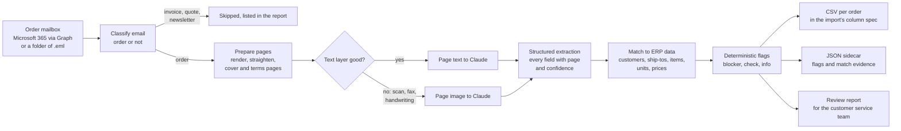

# Architecture

Orderline turns purchase orders that arrive by email as PDFs into CSV files an ERP can import. It prepares orders; it never releases one. Every CSV row carries a review status, and a person decides what goes through.

## Components

| Module | What it does |
|---|---|
| `mail/graph.py` | Reads unread messages with attachments from one Microsoft 365 mailbox through Microsoft Graph v1.0 (app-only), follows `@odata.nextLink`, decodes `fileAttachment.contentBytes`, and marks processed messages read with an `Orderline` category. |
| `mail/folder.py` | The same interface over a folder of `.eml` files, for the demo, tests and on-prem drop folders. |
| `mail/classify.py` | A cheap, explainable first pass: needs a PDF, and more order wording than invoice, quote or newsletter wording. Anything it lets through is checked again by the model (`is_purchase_order`). |
| `pages.py` | Renders each page, keeps the text layer only when it is real, straightens rotated pages, and marks cover sheets and terms pages so they are not sent as order content. |
| `extract/claude.py` | One structured-output call per PDF with the `ExtractedOrder` schema. Text pages go as text, scans as images. Refusals and cut-off responses become a blocker flag, not an exception. |
| `match.py` | Fuzzy and exact matching against the ERP export, each match with its method and a 0 to 100 score. |
| `prepare.py` | Turns one extraction into a prepared order and raises every flag. Pure code, no model. |
| `output.py` | Writes the CSV in the column spec from `config/columns.yaml`, plus a JSON sidecar. |
| `report.py` | A static HTML review page for the batch. |
| `cost.py`, `evaluate.py` | Cost estimates, and field-level scoring against ground truth for `evals/run_eval.py`. |

## Decisions

**The model reads, code decides.** Claude reads the page and reports what is printed, with a page number and its own confidence for each field. Whether a price is off, a part is unknown, a unit is invalid or a PO was already received is decided in code against ERP data, so the same input always gives the same flags, and a flag means the same thing every time.

**No templates per customer.** New customers and new PO layouts work on day one because nothing is keyed to a layout. The cost of that freedom is paid by the review step: anything unusual shows up as a flag.

**Text layer first, vision when it is not trustworthy.** System-generated PDFs carry exact text, which is cheaper and more reliable than reading pixels. Scans, faxes and handwriting usually have no text layer, or a garbage one; those pages go to the model as images.

**Orientation is fixed before the model sees the page.** A sideways scan is detected from the row and column ink profiles (text lines make the row profile spiky), and upside down from the ascender and descender balance of Latin text. When the signal is weak the page is left alone and flagged, because a wrong rotation is worse than none.

**Cover sheets and terms pages are skipped, but nothing is dropped silently.** If no page looks like an order, every page is sent. The model also reports a role for each page.

**Never release, never lose.** Orders with blockers are still written, with `REVIEW_STATUS=blocked` on every row, so the ERP import can hold them and nothing disappears into a log.

**Duplicates are caught before import.** A PO number already seen for the same customer, or the same content under a different number, is flagged. The ERP partner's own duplicate check stays in place; this one just catches resends and fax-plus-email copies earlier.

## Data and security

* The app reads one mailbox with an app registration. Grant `Mail.ReadWrite` (application) and scope it to that mailbox with Exchange Online RBAC for applications, so it cannot read anyone else's mail.
* Secrets (the Graph client secret, the Claude key) live in Key Vault and reach the app as Key Vault references. The function app reads storage with its managed identity; shared keys are disabled on the storage account.
* Order content is sent to the Claude deployment you choose: the Claude API, or Claude on Microsoft Foundry billed through your Azure subscription. Nothing else leaves your tenant, and there are no per-order or per-page fees from Orderline itself.
* All code, documentation and accounts belong to the customer. MIT licensed.
